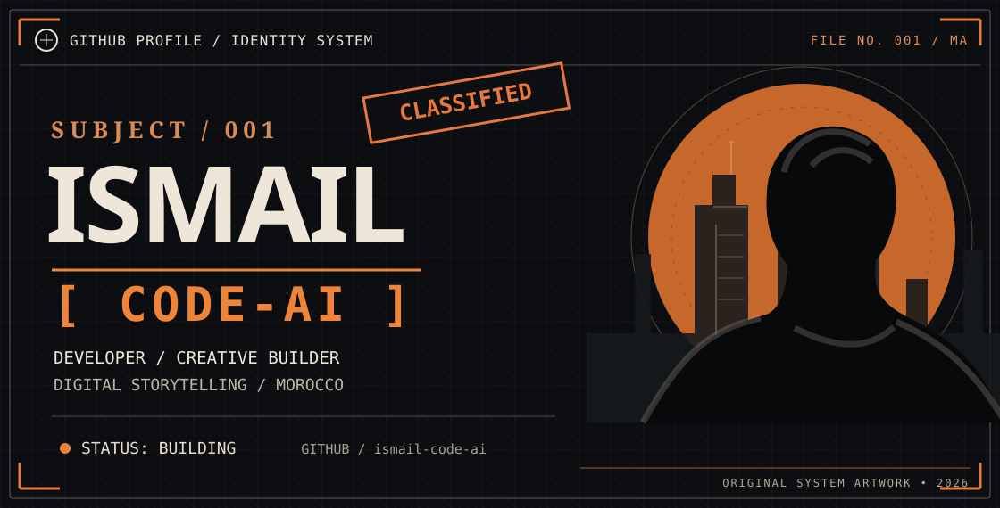
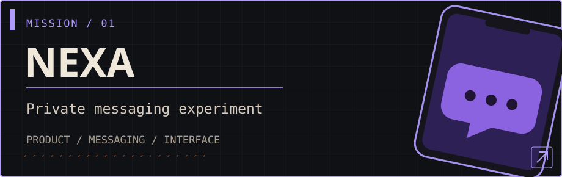
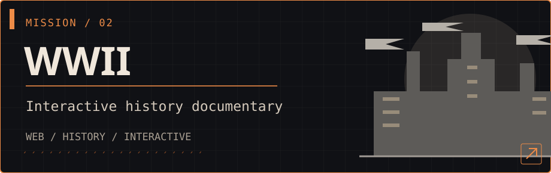
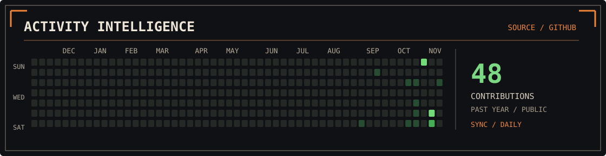

<!-- Original artwork: self-hosted and editable SVG assets, not third-party profile generators. -->
<p align="center">
  
</p>

<p align="center">
  <samp>01 / IDENTITY VERIFIED</samp>
  &nbsp;&nbsp;·&nbsp;&nbsp;
  <samp>MA / MOROCCO</samp>
  &nbsp;&nbsp;·&nbsp;&nbsp;
  <samp>STATUS / BUILDING</samp>
</p>

> I build software, interfaces, and interactive experiences that blend technology, history, and storytelling.

<br>

### `// ACTIVE MISSIONS`

<a href="https://github.com/ismail-code-ai/nexa-messenger">
  
</a>

<a href="https://github.com/ismail-code-ai/ww2-presentation">
  
</a>

<sub>🔒 These repositories are currently private, so only authorized visitors can view their source code.</sub>

<br><br>

### `// FIELD NOTES`

```text
HANDLE     ismail-code-ai
FOCUS      creative development / digital experiences
CRAFT      interfaces / motion / interactive storytelling
MISSION    make software feel intentional
```

### `// TOOLKIT`

`TypeScript` &nbsp; `JavaScript` &nbsp; `React` &nbsp; `Git` &nbsp; `Vite` &nbsp; `Supabase`

### `// ACTIVITY INTELLIGENCE`

<p align="center">
  <a href="https://github.com/ismail-code-ai?tab=overview">
    
  </a>
</p>

<sub>Source: GitHub contribution calendar · Publicly visible activity only · Refreshed daily by a workflow after merging this design into main. The original GitHub contributions chart remains visible below the profile README.</sub>

---

<p align="center">
  <samp>END OF FILE / 001</samp><br>
  <samp>NO TEMPLATE WALLS. JUST WORK IN PROGRESS.</samp>
</p>
