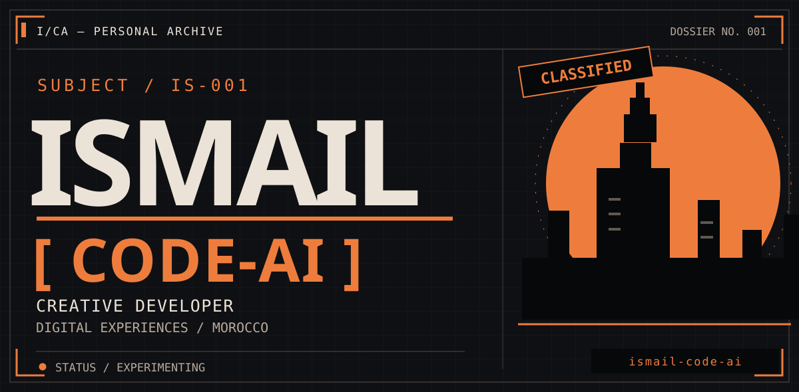
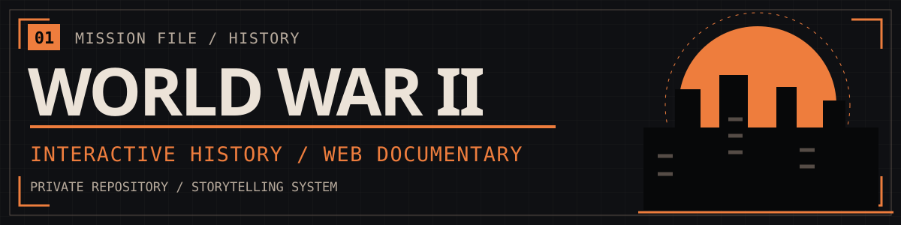
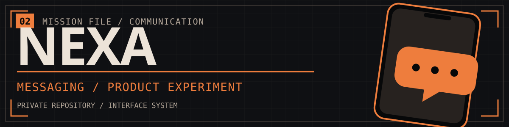
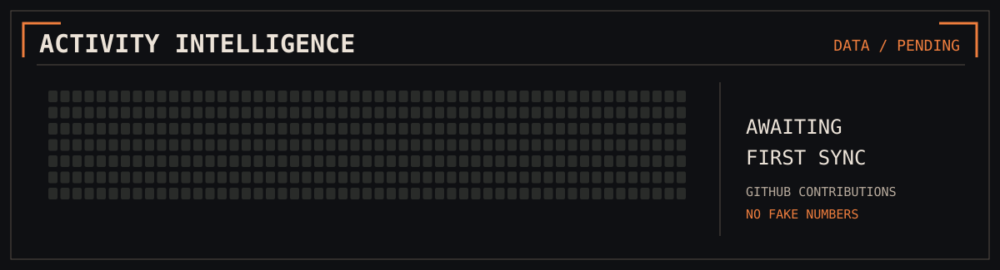
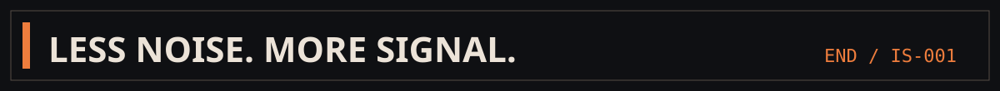

<!-- CLASSIFIED IDENTITY V2 — artwork is authored here, not generated by third-party badge services. -->
<div align="center">
  <picture>
    <source media="(prefers-color-scheme: dark)" srcset="./assets/v2/identity-dark.svg">
    <source media="(prefers-color-scheme: light)" srcset="./assets/v2/identity-light.svg">
    
  </picture>
</div>

<p align="center"><samp>ARCHIVE / 001</samp> &nbsp; · &nbsp; <samp>DEVELOPER + DESIGN + STORY</samp> &nbsp; · &nbsp; <samp>MOROCCO</samp></p>

> I build interfaces and digital experiences where code meets storytelling. Curious about everything between product design, motion and history.

### `01 / SELECTED MISSIONS`

<a href="https://github.com/ismail-code-ai/ww2-presentation">
  <picture>
    <source media="(prefers-color-scheme: dark)" srcset="./assets/v2/mission-wwii-dark.svg">
    <source media="(prefers-color-scheme: light)" srcset="./assets/v2/mission-wwii-light.svg">
    
  </picture>
</a>

A cinematic, scroll-driven exploration of World War II, built as an interactive historical presentation rather than conventional slides.

<a href="https://github.com/ismail-code-ai/nexa-messenger">
  <picture>
    <source media="(prefers-color-scheme: dark)" srcset="./assets/v2/mission-nexa-dark.svg">
    <source media="(prefers-color-scheme: light)" srcset="./assets/v2/mission-nexa-light.svg">
    
  </picture>
</a>

A messaging application experiment exploring interface design, modern app architecture and communication workflows.

<sub>🔒 **PRIVATE PROJECTS:** These repositories are currently private. Their links are accessible only to people with repository permission; the cards remain visible on this public profile.</sub>

### `02 / FIELD EQUIPMENT`

```text
DESIGN       Art direction · UI · Motion
FRONTEND     JavaScript · TypeScript · React · Vite
SYSTEMS      GitHub · GitHub Actions · Supabase
SPECIALTY    Interactive storytelling
```

### `03 / ACTIVITY INTELLIGENCE`

<div align="center">
  <picture>
    <source media="(prefers-color-scheme: dark)" srcset="./assets/v2/activity-dark.svg">
    <source media="(prefers-color-scheme: light)" srcset="./assets/v2/activity-light.svg">
    
  </picture>
</div>

<sub>**Source:** GitHub GraphQL contribution calendar. The activity chart starts as an explicitly labeled placeholder and is updated by GitHub Actions when synchronization first succeeds. No numbers are invented. The original GitHub activity chart below this README is controlled by GitHub.</sub>

### `04 / ACCESS POINTS`

[**ALL REPOSITORIES**](https://github.com/ismail-code-ai?tab=repositories) &nbsp;·&nbsp; [**PROFILE**](https://github.com/ismail-code-ai) &nbsp;·&nbsp; [**SOURCE OF THIS DESIGN**](https://github.com/ismail-code-ai/ismail-code-ai)

<div align="center">
  <picture>
    <source media="(prefers-color-scheme: dark)" srcset="./assets/v2/signoff-dark.svg">
    <source media="(prefers-color-scheme: light)" srcset="./assets/v2/signoff-light.svg">
    
  </picture>
</div>
